# DA12 · Guía de uso: registrar trabajo y revisar respaldos

**Para quién:** funcionarios que registran su trabajo y revisores que aprueban sus respaldos.
**Versión usada:** rama `sgr/incremento-20261114` (commit `c96285a`), ejecutada en local el 25-11-2026.
**Datos:** todos ficticios (`funcionario.demo`, "Vecino Test", PDF de demostración). No se usó AWS.

## Tres cosas distintas, tres decisiones distintas

| Qué es | Quién decide | Dónde se ve |
|---|---|---|
| **Evidencia** (el archivo de respaldo) | El revisor: aprueba, solicita corrección o rechaza | Bandeja de validación · Detalle de evidencia |
| **Actividad** (el trabajo registrado) | Se valida sola cuando **todos** sus respaldos vigentes están aprobados | Mi planilla · Detalle del registro |
| **Seguimiento** (compromiso en el tubo) | El responsable, desde Tubo de trabajo | Tubo de trabajo |

Aprobar una evidencia **no** marca el compromiso del tubo como realizado, y una actividad validada **no** suma a la meta si su tipo no tiene regla de clasificación (ver paso 7).

---

## Parte A · Quien registra (funcionario)

### 1. Abrir el formulario
Inicio → **Registrar actividad o atención**. El sistema muestra quién registra y en qué delegación.

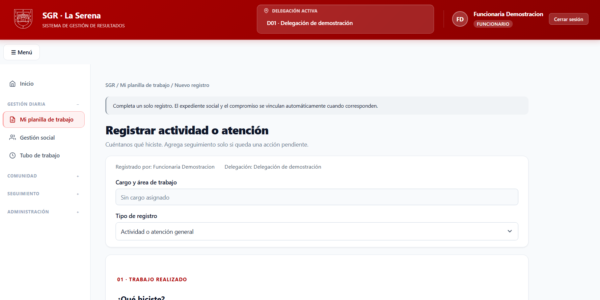

### 2. Elegir la meta asignada
En **Meta individual asignada** aparecen solo tus metas activas para la fecha elegida. Al seleccionarla, el tipo de trabajo queda **fijado por la asignación** y se muestran el objetivo y la ponderación.
Si dejas "Sin asignación de meta", el registro se guarda pero no se vincula a ninguna meta.

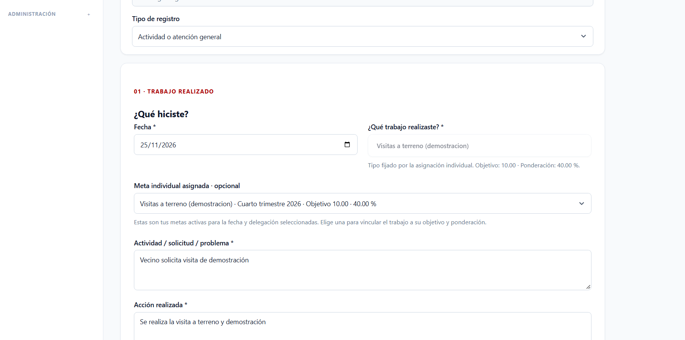

### 3. Completar a quién atendiste y adjuntar el respaldo
Completa nombre, teléfono y sector: **sin nombre o teléfono el registro no aporta a puntos ni metas**. Marca **¿Adjuntar evidencia ahora?** y sube un PDF, PNG o JPG de hasta 10 MB. Marca **¿Queda una acción pendiente?** solo si debe ingresar al tubo.

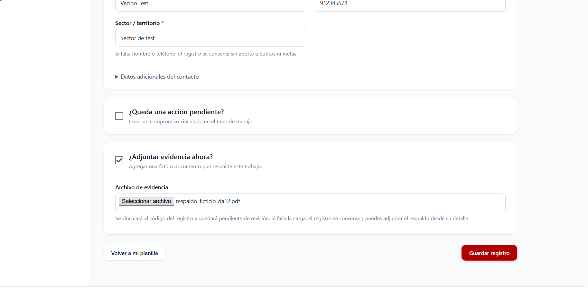

### 4. Guardar y revisar el estado
Al guardar se muestra el código del registro. El aviso **"Clasificación pendiente de configurar"** indica que el trabajo quedó guardado, pero que su tipo aún no tiene regla de puntuación.

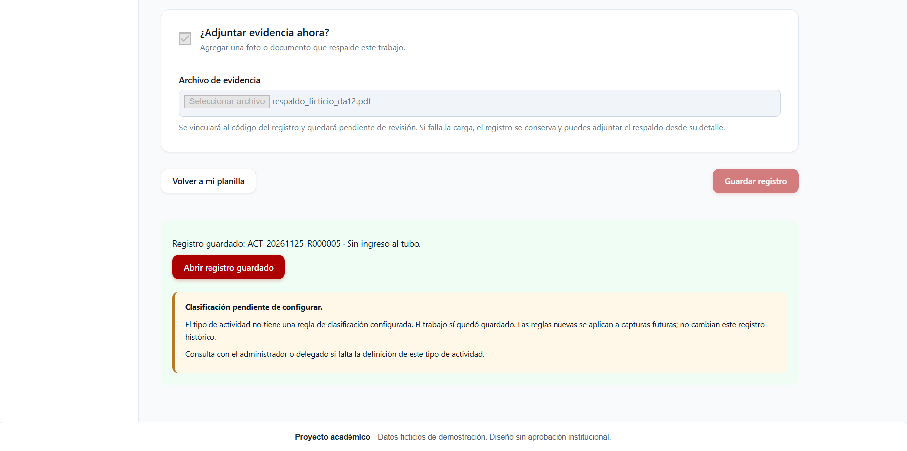

En el detalle, el registro queda **Pendiente**: espera que **otra persona** revise el respaldo. Desde aquí puedes adjuntar más respaldos.

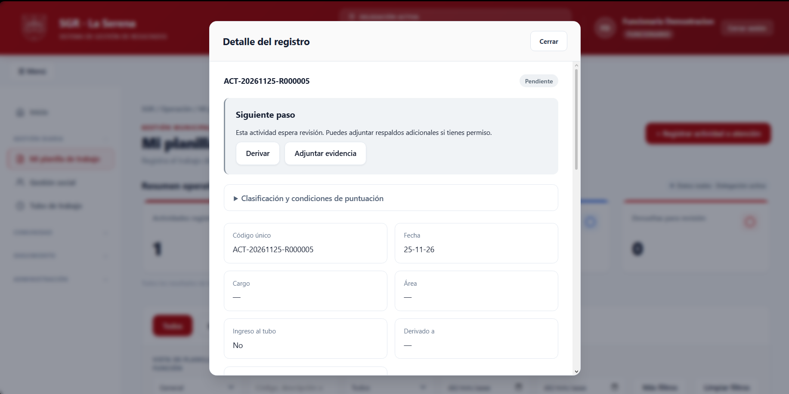

---

## Parte B · Quien revisa (revisor)

### 5. Revisar el respaldo
Seguimiento → **Bandeja de validación**. Por defecto muestra solo pendientes; usa *Estado: Todos* para ver también los revisados. El autor nunca puede revisar su propia evidencia.

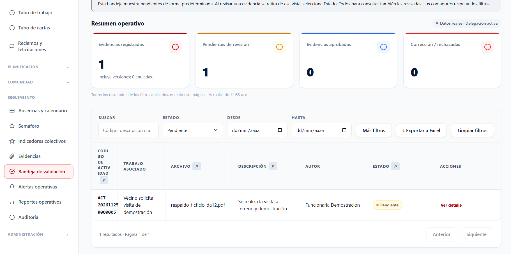

Abre **Ver detalle**, descarga el archivo, escribe la **observación** (obligatoria) y decide:
- **Aprobar**: el respaldo es conforme.
- **Solicitar corrección**: falta un antecedente; el autor podrá responder con una nueva versión.
- **Rechazar**: el respaldo no corresponde.

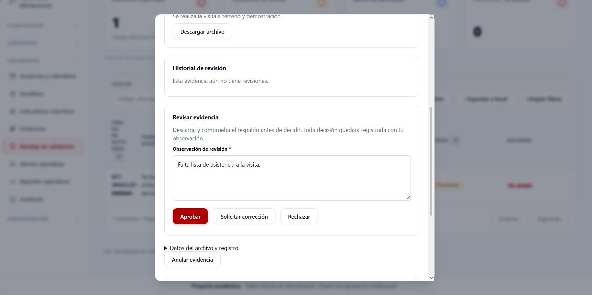

---

## Parte C · Responder antecedentes (funcionario)

### 6. Ver qué se pidió y enviar la nueva versión
En Inicio, **Mis pendientes** muestra "evidencias por corregir" con la etiqueta *Requiere tu acción*.

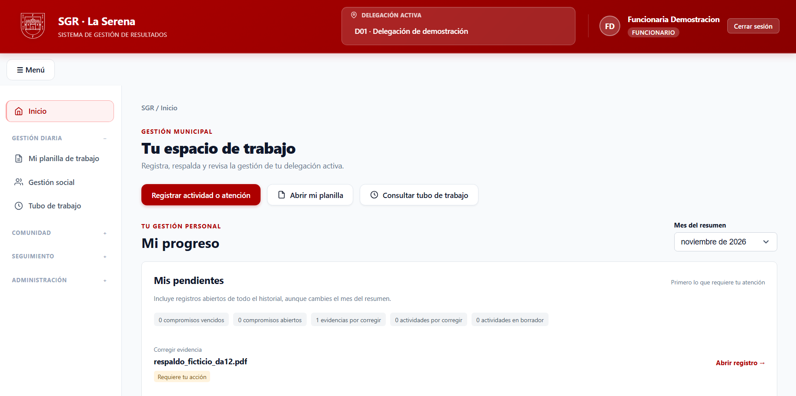

Abre el registro, lee la observación del revisor y presiona **Corregir evidencia**. Adjunta el nuevo archivo, describe qué agregas y en **Evidencia devuelta que reemplaza** elige el respaldo anterior. La versión anterior **no se borra**: queda en el historial.

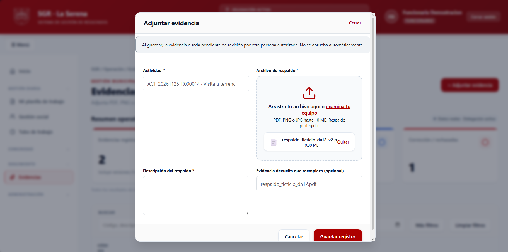

El registro vuelve a **Pendiente** con el respaldo nuevo.

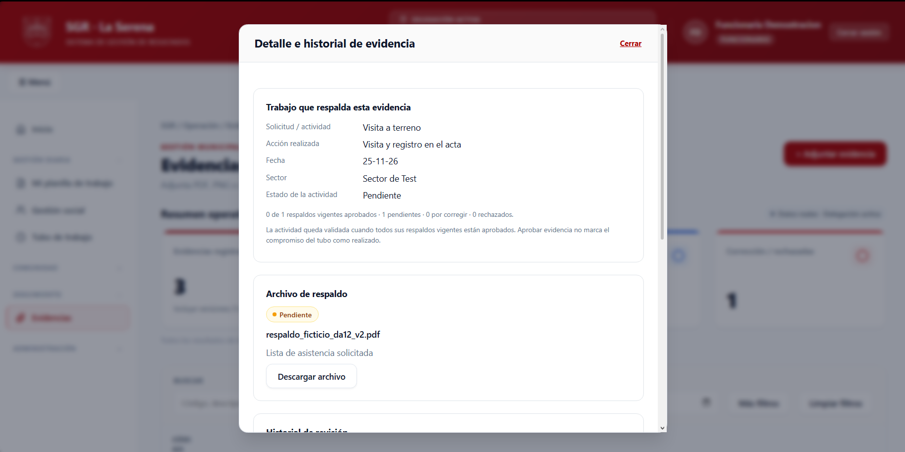

El revisor la ve en su Inicio como "evidencias que debes revisar".

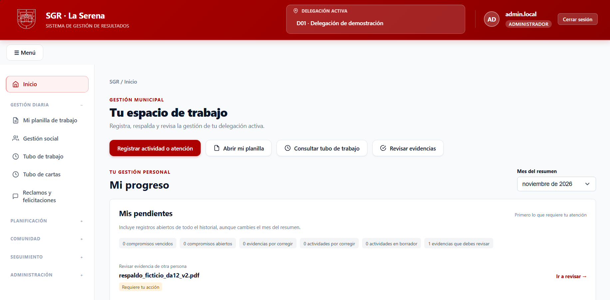

---

## Parte D · Resultado y consulta

### 7. Aprobado, pero sin ponderar
Cuando el revisor aprueba, la actividad pasa a **Validada**. El detalle conserva **todas las versiones** (aprobada y anterior en corrección).

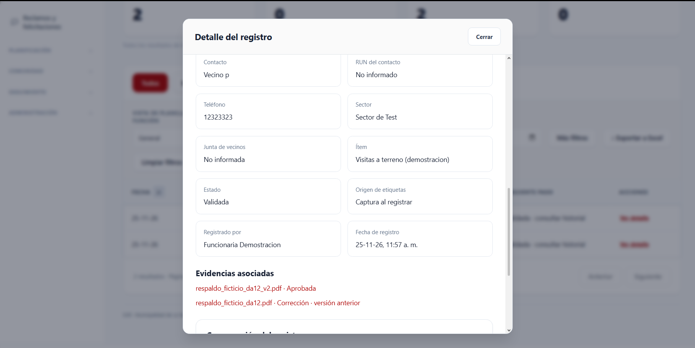

En **Clasificación y condiciones de puntuación** se ve si el trabajo **suma**. En este ejemplo dice *"No elegible · Sin definir"*: la actividad está aprobada, pero su tipo no tiene regla de clasificación, así que **no otorga puntos ni confirma cumplimiento de metas**. Para que sume, el administrador o delegado debe configurar la regla en *Clasificación de actividades*; la regla se aplica a registros futuros, no cambia los ya guardados.

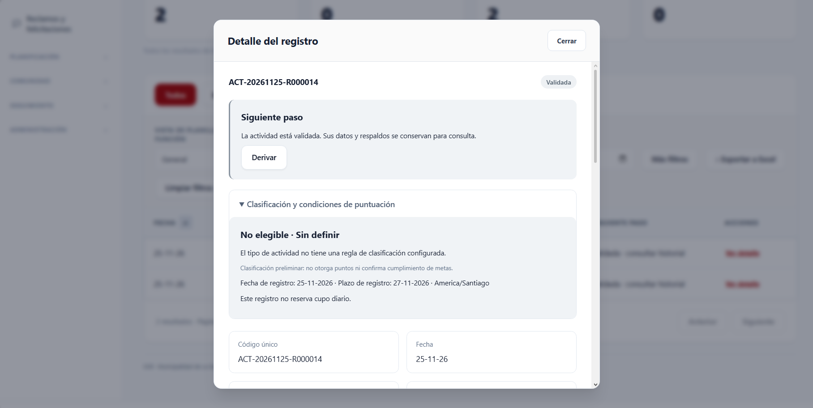

### 8. Consultar en Mi planilla
**Mi planilla de trabajo** resume tus registros (registrados, pendientes, validados y devueltos) y permite filtrar por estado, fecha o palabra.

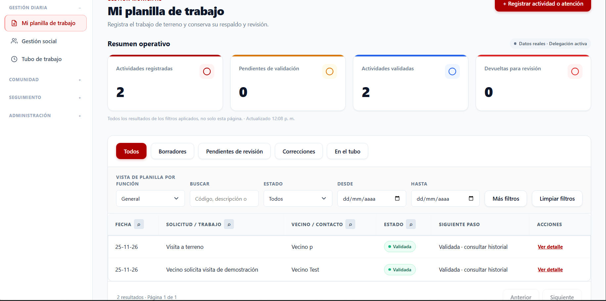

---

## Resumen rápido

1. Registrar → elegir meta → completar contacto → adjuntar respaldo → guardar.
2. El revisor aprueba, solicita corrección o rechaza, siempre con observación.
3. Si piden corrección: leer la observación → **Corregir evidencia** → nueva versión que reemplaza a la anterior.
4. Aprobado ≠ suma a la meta: revisar **Clasificación y condiciones de puntuación**.

## Notas para el revisor del PR

- Las capturas se tomaron en local con la rama `sgr/incremento-20261114`; si esa rama cambia antes de integrarse, hay que repetir las capturas afectadas.
- Datos de demostración creados solo en la base local (`sgr_local`): rol "Funcionario", usuario `funcionario.demo`, período "Cuarto trimestre 2026", ítem "Visitas a terreno (demostracion)" y su meta asignada.
- No se configuró regla de clasificación a propósito, para mostrar el caso "aprobado sin ponderar".
